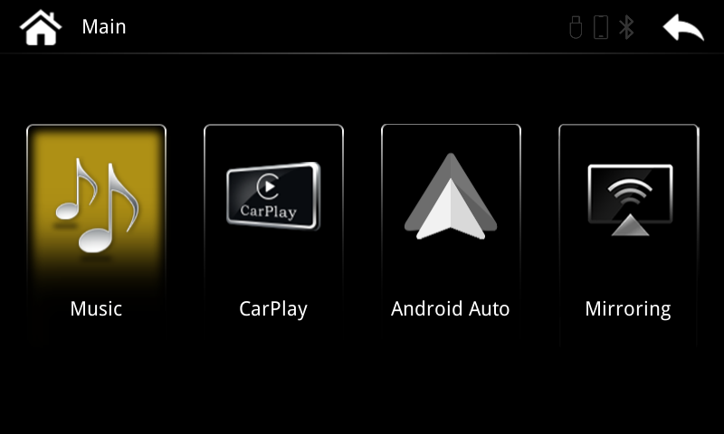

# P401 CarPlay Revival

Firmware fixes and technical research for the Limcet/Arkmicro P401 CarPlay interface family. Native wireless CarPlay was restored on a Jaguar XFR installation using the existing hardware and Apple authentication implementation.

**This update does not back up your current firmware. Flashing can make the unit unusable. Neither the maintainer nor this project provides a recovery firmware, recovery route, or recovery method if it fails. Use it entirely at your own risk.**

## Download

[**2026.11-w3-rc1 — combined firmware, without diagnostic logging**](releases/2026.11-w3-rc1/README.md)

The download contains the newer vendor menu software, its matching Linux 3.4.0 kernel, Wi-Fi advertisement correction, native CarPlay link-local fix and corrected DHCP server. Extract the ZIP and copy its **three files** to the root of a clean FAT32 USB: `update`, `zImage`, `rootfs.img`.

**Read the [installation instructions](docs/installation.md) and [compatibility limits](docs/compatibility.md) first.** There is no firmware backup step or supported rollback. Existing MCU, screen, Bluetooth, Wi-Fi and factory configuration is retained; no one else's configuration export is installed. If the saved mode is USB-only, it stays USB-only until you change the iPhone link setting yourself.

## What is proven

The owner confirmed native wireless CarPlay on the original staged R1 + W2 + W3 installation. Captures independently show successful authentication, an IPv6 control connection, screen frames and touch input. The control request received HTTP 200 before DHCP completed.

The combined no-logger image uses those same UI/kernel components and the exact successful patched CarPlay library and DHCP binary. **This exact consolidated image has been checked offline; it has not yet been flashed and tested in a vehicle.** It is therefore labelled `rc1`. One successful box does not establish compatibility with other MCUs or all iOS releases.

## The fix

- **Wi-Fi advertisement:** enable the existing `interworking=1` template option.
- **CarPlay control connection:** remove a Wi-Fi-specific exclusion of link-local addresses by changing one ARM instruction, affecting two bytes in `libAirPlay.so`.
- **DHCP:** use a small static ARM build of BusyBox 1.38.0 `udhcpd`, whose corrected reply logic unicasts OFFER/ACK for the captured phone's request flags.

The kernel already supported IPv6. No new kernel implementation, MFi bypass, replacement Apple authentication, or Ottocast binary transplant was needed.

## Read more

| Document | Contents |
| --- | --- |
| [Installation](docs/installation.md) | USB layout, update procedure, preserved settings and failure limitations |
| [Compatibility](docs/compatibility.md) | Tested hardware, P-number meanings and unsupported assumptions |
| [Wireless failure and repair](docs/wireless-fix.md) | Exact patch, DHCP change, evidence and causal limits |
| [System architecture](docs/architecture.md) | Boot, configuration, Qt menu, MCU dispatch and CarPlay |
| [Build and verification](docs/building.md) | Rebuild the image and validate a download |
| [Provenance](docs/provenance.md) | Source versions, hashes and third-party components |
| [FAQ](docs/faq.md) | iOS 17, kernel changes, MFi and emulation |
| [Field evidence](evidence/w3-field-summary.json) | Redacted machine-readable results from the successful installation |

The screenshot is the actual vendor application running under QEMU with a framebuffer shim. It illustrates the menu family, not a complete vehicle emulator. The newer menus come from the vendor V3.22.1 software; the separate community replacement UI is not included.

## Contributing

See [CONTRIBUTING.md](CONTRIBUTING.md). Keep hardware reports specific, distinguish offline results from vehicle tests, and do not upload pairing data or raw phone captures. The repository includes build tooling and BusyBox source; proprietary vendor components remain subject to their own rights. See [THIRD_PARTY_NOTICES.md](THIRD_PARTY_NOTICES.md).
