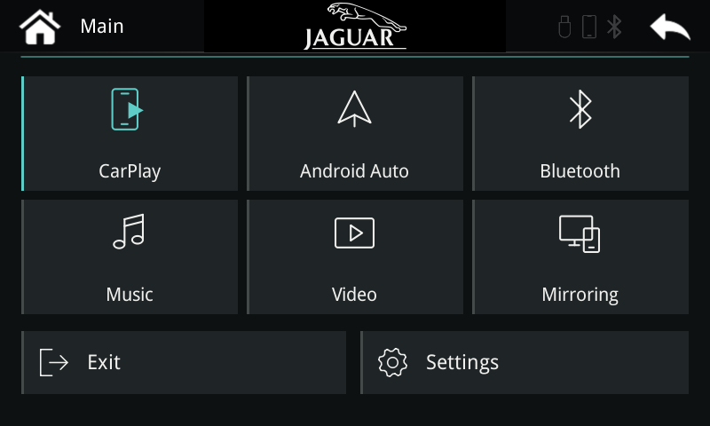

# Jaguar UI1 — experimental

Six large tiles, permanent **Exit** and **Settings** buttons, turquoise illumination and a centred Jaguar leaper/wordmark. Settings adds a custom CarPlay name and **Save & restart**. The saved name feeds Bluetooth, Wi-Fi and CarPlay's advertised SSID.

**Status:** the actual ARM GUI passed PC tests. This extension's physical radio renaming and automatic reboot have not been tested in the car. The existing W3 wireless CarPlay fix has worked in the car.

These packages target the existing **R1 + field W3 installation** used during development. They are not a universal update or an add-on for an arbitrary P401 installation. The public RC1 combined firmware uses a different startup layout; do not apply UI1 to it without adapting and checking that integration.

## Install on the matching development installation

1. Download [INSTALL.zip](packages/INSTALL.zip). Extract its **msn_autocopy** folder directly onto a FAT32 USB.
2. Insert it into the running box and wait for autocopy to complete.
3. Remove the USB, then fully power-cycle the box.
4. Open **Settings → CarPlay name** to change the name. Use 1–24 English letters, digits, spaces, hyphens or underscores. **Save & restart** applies it after reboot; forget the old phone pairing and pair again if necessary.

The name option is enabled for Bluetooth type 3 (SD-RDA). Existing MCU and factory settings are retained.

## Undo

Extract [ROLLBACK.zip](packages/ROLLBACK.zip) and use its **msn_autocopy** folder the same way. It restores the exact prior GUI runner and W3 manifest, disables UI1 and retains the wireless fix. The saved custom name is ignored after rollback.

For a ready USB, an inactive rollback folder can be named **msn_autocopy_rollback**. The updater only recognises the exact name **msn_autocopy**. To switch, rename the active folder out of the way, then rename the rollback folder to **msn_autocopy**. Remove the USB after completion before the next normal startup.

**This does not back up the firmware. Install at your own risk. Rollback requires a box that still boots and accepts autocopy; I offer no recovery image or method for a bricked unit.**

[Build and lab notes](BUILDING.md) · [Exact package hashes](packages/MANIFEST.json) · [Cloud handover](../../docs/cloud-handover.md)
