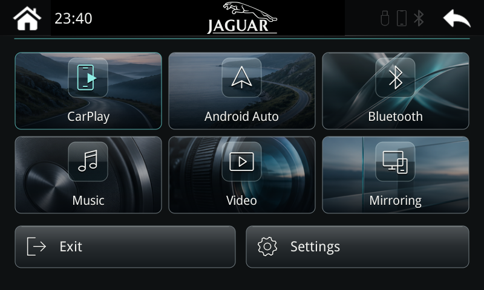

# Complete firmware — stock-to-Jaguar RC1

7 November 2026. A complete update for compatible **stock Limcet/Arkmicro P401 units with an 800×480 display**. It includes the newer vendor firmware/kernel, W3 native wireless CarPlay repair, Jaguar glass/photo menu, live clock, fixed Exit/Settings footer and custom Bluetooth/Wi-Fi/CarPlay name.

No prior R1 installation, field-W3 scripts or separate UI overlay is needed. The full package installs the components together and uses a standalone launcher. Existing factory/MCU settings remain authoritative.

**New full-image release candidate:** the exact UI library and W3 components have worked on my development box, and this combined image passed fresh offline/native tests. I have not yet installed this exact complete image in a vehicle. The earlier successful overlay test is not a test of this new full image.

## Compatibility

Use only the matching P401 hardware, bootloader/NAND format and existing native configuration layout described in [compatibility](../../docs/compatibility.md). The unit must already have readable, nonempty `MsnProductInfo.ini` and `FactoryConfig.ini` under `/data/msncfg`, with a `[General]` section. Stock units using a different settings layout are not covered. Missing settings stop hardware startup; another unit's defaults are never substituted.

The car model alone is not proof of compatibility. Custom naming remains enabled only for the verified SD-RDA Bluetooth type 3. Keep your existing MCU and factory selections.

## Install from stock

[**Download P401_2026.11_JAGUAR_XFR_RC1.zip**](https://github.com/cs2000/p401-carplay-revival/raw/refs/heads/main/releases/2026.11-jaguar-xfr-rc1/P401_2026.11_JAGUAR_XFR_RC1.zip)

**This is a full firmware update. It writes the kernel and root filesystem. It does not back up your firmware. A failed flash can brick the unit; I offer no recovery image or method for an unbootable box. Use at your own risk.**

1. Read compatibility, then extract the download on your computer.
2. Use an empty **FAT32 USB drive under 16 GB**. Copy **update**, **zImage** and **rootfs.img** directly to its root. Do not include any `msn_autocopy`, factory-config, bootloader or other updater payloads.
3. With the vehicle parked and stable power available, insert the USB and restart the box.
4. Wait for completion without interrupting power or removing the USB. Follow the completion prompt and remove the USB before normal startup.
5. If your saved mode is USB-only, select **USB & Wireless CarPlay**, then pair your phone. Keep the existing MCU setting.

`update` is the filename, without an extension. The Jaguar menu is already in the image. A fresh installation starts it without an enable file or development setup.

Open **Settings → CarPlay name → Change name** to set 1–24 English letters, digits, spaces, hyphens or underscores. Use **Continue → Save & restart**; re-pair the phone if needed.

## UI rollback and re-enable

[**UI_ROLLBACK.zip — return to the included native interface**](UI_ROLLBACK.zip) · [**ENABLE_JAGUAR_UI.zip — enable the Jaguar interface**](ENABLE_JAGUAR_UI.zip)

Use these separately from the full firmware USB: extract the chosen ZIP's **msn_autocopy** folder to an otherwise clean FAT32 USB, insert it into the running box, wait for autocopy, remove the USB, then power-cycle. Each bundle changes only the UI enable/disable state; the W3 repair, factory settings and saved custom name are retained. If an earlier UI rollback left the theme disabled, the enable bundle restores it after this full update.

These controls require a box that still boots and accepts autocopy. They do not restore the previous firmware or provide full-flash recovery. The older field-layout overlay and its exact rollback remain [available separately](../2026.11-ui1-jaguar-xfr/README.md).

## Evidence and build notes

The new startup works without the field-W3 directory or marker. It checks the UI/vendor files, falls back to the included native interface on incompatibility/crash/startup timeout, and keeps wireless repair independent of the theme. Factory configuration is read rather than copied from my car.

[Checksums](SHA256SUMS.txt) · [Manifest](MANIFEST.json) · [Validation summary](VALIDATION.json) · [Source](SOURCE.zip) · [Build notes](../../docs/building.md)

Offline results cover the full filesystem inventory/metadata and UBI geometry, ARM startup and settings guards, standalone watchdog/failure cases, verifier legacy-syscall fallback, and actual native UI/name-save/reload through the integrated launcher. They do not emulate the bootloader, kernel boot, MCU, physical radios, iPhone session or full-flash recovery. The preview is a native ARM capture using a synthetic test profile.
