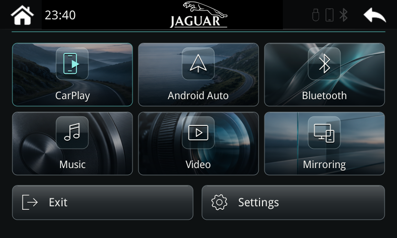

# Legacy UI-only overlay — existing R1 + field-W3 units

**Starting from stock? Use the [complete Jaguar firmware bundle](../2026.11-jaguar-xfr-rc1/README.md).** It installs the firmware, wireless repair and Jaguar UI together. This folder preserves the smaller, owner-tested overlay for the older development startup layout.

7 November 2026. Six large photographic/glass tiles, turquoise accents, the centred Jaguar leaper/wordmark, a live clock, fixed Exit/Settings footer and a custom Bluetooth/Wi-Fi/CarPlay name with **Save & restart**.

I've tested this exact package on my P401 in my Jaguar XFR. On 7 November I reported that all the previously reported bugs were fixed. This is one owner's result, not a compatibility claim for every Jaguar or P401.

## Check compatibility first

**Requires the matching R1 + field-W3 development installation and vendor files. This overlay is not directly compatible with the clean public `2026.11-w3-rc1` startup layout. Do not install it just because the car is an XF-R.** The tested display is 800×480; custom naming requires the verified SD-RDA Bluetooth type 3. Existing factory/MCU settings are retained—do not copy my settings onto another unit.

[Compatibility details](../../docs/compatibility.md) · [Startup/build details](../../experimental/ui1/BUILDING.md)

## Install

[**Download INSTALL.zip**](https://github.com/cs2000/p401-carplay-revival/raw/refs/heads/main/releases/2026.11-ui1-jaguar-xfr/INSTALL.zip)

1. Extract the ZIP. Put its **msn_autocopy** folder at the root of a FAT32 USB, replacing any previous active folder. Do not merge installer and rollback payloads or mix in full-firmware updater files.
2. Insert it into the running box and wait for autocopy to complete.
3. Remove the USB, then fully power-cycle the box.
4. To rename it, open **Settings → CarPlay name → Change name**, enter 1–24 English letters, digits, spaces, hyphens or underscores, then **Continue → Save & restart**. Forget the old phone pairing and pair again if needed.

## Recovery / undo

[**Download the UI rollback bundle — ROLLBACK.zip**](https://github.com/cs2000/p401-carplay-revival/raw/refs/heads/main/releases/2026.11-ui1-jaguar-xfr/ROLLBACK.zip)

Use its **msn_autocopy** folder the same way. This exact preserved rollback restores the previous GUI runner and W3 manifest, disables UI1 and retains the wireless repair. An inactive **msn_autocopy_rollback** folder can be kept on the USB; move the active folder out of the way before renaming rollback to **msn_autocopy**. Remove the USB after completion.

**This is UI rollback for a box that still boots and accepts autocopy. It is not full-flash recovery. This does not back up the firmware; install at your own risk. I offer no recovery image or method for an unbootable unit.**

## Files and evidence

The installer is byte-for-byte the one I tested: SHA256 `3fffedb75dd811ea6a41f0c81f756ced773b41a472420e6ff7f2c038dfead383`. The rollback is unchanged. No device binary was rebuilt for publication.

[Source ZIP](SOURCE.zip) · [Checksums](SHA256SUMS.txt) · [Release manifest](MANIFEST.json) · [Reported vehicle result](FIELD_TEST.json) · [Native PC checks](NATIVE_EVIDENCE.json) · [Delivery checks](DELIVERY_CHECKS.json)

The native/delivery evidence and source archive retain their packaging-time scope. The later owner-reported device result is recorded separately; it does not establish full-flash recovery, long-term reliability or compatibility with other hardware. `HOME.png` is an actual ARM framebuffer capture using a synthetic English app model.
